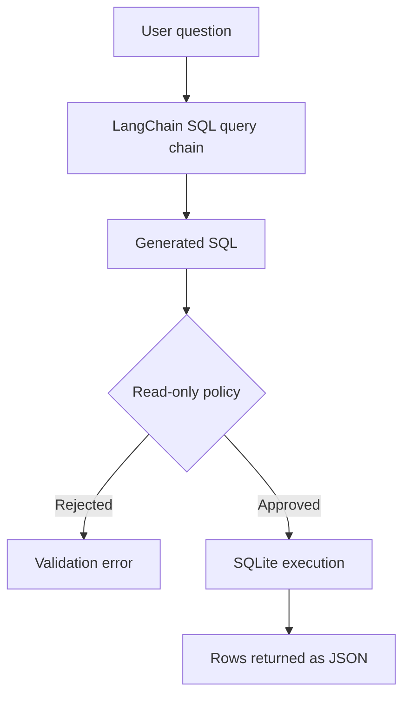

# Natural Language SQL Agent

A read-only natural-language-to-SQL API built with LangChain, OpenAI, SQLAlchemy, and FastAPI. It translates a user's question into a SQL query, validates that query against a strict read-only policy, executes it against a local SQLite database, and returns the result.

> **Safety boundary:** This demo is restricted to a local SQLite database and read-only `SELECT` statements. It is not intended for production databases without authentication, authorization, query timeouts, row limits, audit logging, and database-level least-privilege controls.

## Features

- Natural-language question to SQL using LangChain's SQL query chain
- SQL validation before execution (single read-only SELECT only)
- SQLite sample database with synthetic employee and department data
- FastAPI endpoint with automatic Swagger documentation
- Clear separation between query generation, policy validation, and execution
- Unit tests for unsafe SQL rejection

## Architecture



## Quick start

Python 3.10+

```bash
python -m venv .venv
# Windows PowerShell: .venv\\Scripts\\Activate.ps1
# macOS/Linux: source .venv/bin/activate
pip install -r requirements.txt
```

Set your API key in the environment:

```bash
# Windows PowerShell
$env:OPENAI_API_KEY="your-key"

# macOS/Linux
export OPENAI_API_KEY="your-key"
```

Initialize the synthetic database and start the API:

```bash
python -m app.seed
uvicorn app.main:app --reload
```

Open `http://127.0.0.1:8000/docs`.

## Example request

```json
{
  "question": "Which department has the highest average salary?"
}
```

Send it to `POST /query`.

## Run tests

```bash
pytest -q
```

Tests for the SQL policy do not require an OpenAI API key.

## Configuration

- `OPENAI_API_KEY`: required for natural-language SQL generation
- `OPENAI_MODEL`: optional model override; defaults to `gpt-4o-mini`
- `DATABASE_URL`: optional SQLAlchemy URL; defaults to the local SQLite demo database

## Important limitations

- Uses synthetic demonstration data only.
- The API is unauthenticated and intended for local development.
- The SQL validator is a demonstration guardrail, not a substitute for database permissions or a production SQL security review.
- No real medical, insurance, customer, or employee records are included.

## Potential next steps

- Add PostgreSQL support and migrations
- Add database-level read-only credentials and per-user table permissions
- Add query timeouts, result-size limits, and audit trails
- Add evaluation datasets for SQL correctness and execution accuracy
- Add LangSmith tracing for query-generation workflows
